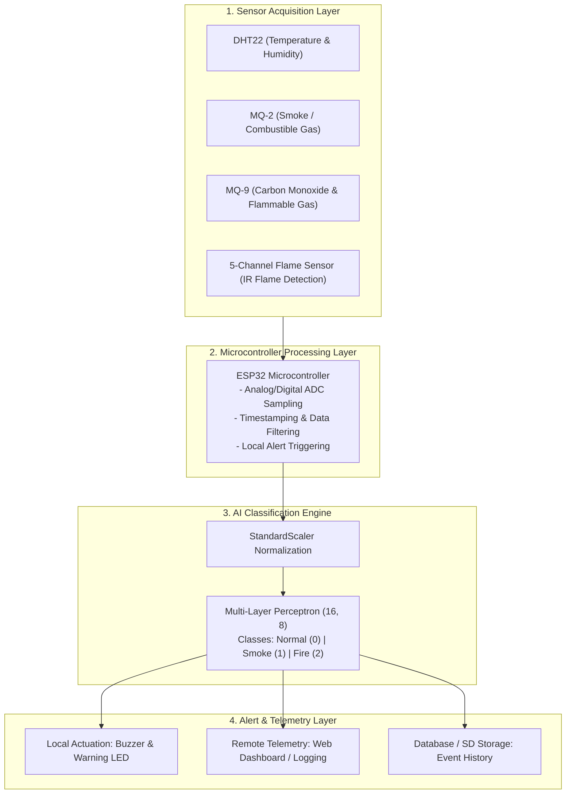

# AI-Integrated Early Fire Warning System

[](https://www.python.org/)
[](https://scikit-learn.org/)
[](https://pandas.pydata.org/)
[](https://www.espressif.com/)
[](LICENSE)

An intelligent, multi-sensor early fire detection and warning system designed for underground parking environments. The project combines **IoT embedded sensing (ESP32)** with a **Multi-Layer Perceptron (MLP) Neural Network** to achieve high-accuracy, low-latency fire and smoke risk classification while drastically minimizing false alarms caused by vehicle exhaust and environmental dust.

Developed as a Capstone Engineering Project (PBL3) at the **Faculty of Advanced Science and Technology (FAST), The University of Danang – University of Science and Technology (DUT)**.

---

## Table of Contents
- [Project Overview](#-project-overview)
- [System Architecture](#-system-architecture)
- [Hardware & Sensor Layer](#-hardware--sensor-layer)
- [Dataset & Preprocessing](#-dataset--preprocessing)
- [AI Model & Benchmarking](#-ai-model--benchmarking)
- [Experimental Results](#-experimental-results)
- [Repository Structure](#-repository-structure)
- [Quickstart Guide](#-quickstart-guide)
- [Project Team](#-project-team)
- [License & References](#-license--references)

---

## Project Overview

Underground parking basements present hazardous fire environments: low illumination (<50 lux), high concentrations of vehicle emissions ($CO, CO_2$), limited ventilation, and dense arrangement of vehicles. Conventional threshold-based fire detectors frequently trigger false alarms from engine exhausts or fail to detect smoldering fires early.

### Key Objectives
- **Multi-Sensor Fusion:** Real-time data aggregation from thermal, smoke, gas, and optical flame sensors.
- **AI-Driven Edge Intelligence:** Lightweight Multi-Layer Perceptron (MLP 16,8) classifier optimized for embedded/edge deployment.
- **Safety-Critical Metric Optimization:** Maximizing **Recall** and **$F_2$-Score** for hazardous classes (`Smoke` and `Fire`) to eliminate catastrophic **Type II Errors (False Negatives)**.
- **Resilience to Environmental Noise:** Robust discrimination between authentic fire signatures and ambient disturbances (exhaust gas, dust, humidity fluctuations).

---

## System Architecture

The end-to-end system follows a modular 4-tier pipeline:



---

## Hardware & Sensor Layer

| Component | Function / Measured Feature | Output Signal |
| :--- | :--- | :--- |
| **ESP32** | Embedded MCU, ADC acquisition, data transmission, fast actuation | Digital / Wi-Fi |
| **DHT22** | Ambient Temperature (`temp_c`) & Relative Humidity (`hum_pct`) | 1-Wire Digital |
| **MQ-2** | Smoke and general flammable gas concentration (`mq2_raw`) | Analog (0–4095) |
| **MQ-9** | Carbon Monoxide ($CO$) and gas concentration (`mq9_raw`) | Analog (0–4095) |
| **5-Channel Flame Sensor** | Multi-directional infrared flame detection (`f1, f2, f3, f4, f5`) | 5x Digital (0/1) |
| **Alarm Output** | High-decibel Buzzer & visual Warning LED indicator | GPIO Actuation |

---

## Dataset & Preprocessing

The dataset was collected empirically from a prototype test chamber under controlled scenarios mimicking underground parking facilities across daytime, nighttime, and low-light conditions.

### 1. Data Split & Class Distribution
The dataset is partitioned into three strictly independent subsets with perfectly balanced classes:

| Subset | Ratio | Total Samples | Normal (Class 0) | Smoke (Class 1) | Fire (Class 2) |
| :--- | :---: | :---: | :---: | :---: | :---: |
| **Training Set** | 70% | **2,709** | 903 | 903 | 903 |
| **Validation Set** | 10% | **387** | 129 | 129 | 129 |
| **Testing Set** | 20% | **774** | 258 | 258 | 258 |
| **Total** | 100% | **3,870** | 1,290 | 1,290 | 1,290 |

### 2. Preprocessing & Augmentation Strategy
- **Feature Selection (9 Inputs):** `temp_c`, `hum_pct`, `mq2_raw`, `mq9_raw`, `f1`, `f2`, `f3`, `f4`, `f5`.
- **Target Label (3 Classes):** `0: Normal`, `1: Smoke`, `2: Fire`.
- **Targeted Training Augmentation:** To boost model generalization against sensor drift and noise, Gaussian perturbation ($\sigma = 2\% \times \text{std}$) was applied **only** to the training set analog signals (`temp_c`, `hum_pct`, `mq2_raw`, `mq9_raw`). Digital flame signals and ground-truth labels were strictly preserved.
  - Training samples expanded: **2,709 $\rightarrow$ 3,249 samples**.
- **Standardization:** Input features normalized via `StandardScaler` ($\mu = 0, \sigma = 1$) fitted strictly on training data.

---

## AI Model & Benchmarking

To rigorously validate the necessity and superiority of neural sensor fusion, three distinct models representing progressive tiers of complexity were benchmarked:

1. **Dummy Classifier (Zero-Intelligence Baseline):** Predicts via `most_frequent` class. Serves as a sanity check to verify non-random discriminative capability.
2. **Gaussian Naive Bayes (Probabilistic Baseline):** Assumes conditional feature independence. Demonstrates that simple linear/probabilistic boundaries are suboptimal for cross-correlated sensor dynamics.
3. **Core Model — Multi-Layer Perceptron (MLP 16,8):**
   - **Architecture:** Input (9 features) $\rightarrow$ Dense (16, ReLU) $\rightarrow$ Dense (8, ReLU) $\rightarrow$ Softmax Output (3 classes).
   - **Optimizer:** Adam ($\alpha = 0.0005, \text{learning rate init} = 0.001$, adaptive schedule).
   - **Regularization:** Early stopping with 15% validation fraction, $L_2$ weight decay.

---

## Experimental Results

### 1. Benchmark Comparison Table

| Model | Evaluation Dataset | Accuracy | Precision (Macro) | Recall (Macro) | $F_1$-Score | $F_2$-Score | Normal Recall | Smoke Recall | Fire Recall | Overfit Status |
| :--- | :--- | :---: | :---: | :---: | :---: | :---: | :---: | :---: | :---: | :---: |
| **MLP (16,8)** *(Core)* | **Train** | **0.9937** | **0.9938** | **0.9937** | **0.9937** | **0.9937** | 1.0000 | 0.9978 | 0.9834 | No overfit |
| | **Validation** | **0.9948** | **0.9949** | **0.9948** | **0.9948** | **0.9948** | 1.0000 | 1.0000 | 0.9845 | No overfit |
| | **Test** | **0.9935** | **0.9936** | **0.9935** | **0.9935** | **0.9935** | **1.0000** | **0.9961** | **0.9845** | **Optimal** |
| **Gaussian NB** | Train | 0.8929 | 0.9105 | 0.8929 | 0.8920 | 0.8903 | 0.9790 | 0.7243 | 0.9756 | No overfit |
| | Validation | 0.8915 | 0.9161 | 0.8915 | 0.8914 | 0.8885 | 0.9457 | 0.7287 | 1.0000 | No overfit |
| | Test | 0.8760 | 0.8962 | 0.8760 | 0.8748 | 0.8729 | 0.9690 | 0.6938 | 0.9651 | Suboptimal |
| **Dummy Baseline** | Test | 0.3333 | 0.1111 | 0.3333 | 0.1667 | 0.2381 | 1.0000 | 0.0000 | 0.0000 | Non-functional |

### 2. Confusion Matrix on Test Set (774 unseen samples)

```
                Predicted Normal    Predicted Smoke    Predicted Fire
Actual Normal         258                  0                  0
Actual Smoke            1                257                  0
Actual Fire             1                  3                254
```

### 3. Critical Safety Takeaways
- **Zero Critical False Negatives:** There is **0% chance** of an actual fire being misclassified as Normal ($0$ Fire $\rightarrow$ Normal misclassifications).
- **Near-Perfect Hazard Sensitivity:** Recall on **Fire** is **98.45%** and Recall on **Smoke** is **99.61%**.
- **100% Normal Baseline Accuracy:** Normal conditions achieved **100.0% Recall** (258/258), eliminating false fire sirens during safe operations.
- **$F_2$-Score Prioritization:** By weighting Recall twice as heavily as Precision ($F_2 = 0.9935$), the model guarantees maximal sensitivity for life-critical early fire detection.

---

## Repository Structure

```
AI-Integrated-Early-Fire-Warning-System/
├── Report_AI_Integrated_Early_Fire_Warning_System.pdf   # Complete 36-page Project Report (PDF)
├── TRAIN_AI_9_6.py                                     # Core AI model training & evaluation script
├── train_ai.py                                         # CLI entry point for training pipeline
├── fire_train_70.xlsx                                  # 70% Training dataset (Excel format)
├── fire_train_70.csv                                   # 70% Training dataset (CSV format)
├── fire_validation_10.xlsx                             # 10% Validation dataset (Excel format)
├── fire_validation_10.csv                              # 10% Validation dataset (CSV format)
├── fire_test_20.xlsx                                   # 20% Unseen Testing dataset (Excel format)
├── fire_test_20.csv                                    # 20% Unseen Testing dataset (CSV format)
├── mlp_fire_detection_model.pkl                        # Serialized trained MLP model pipeline
├── model_comparison_results.xlsx                       # Multi-model benchmarking comparison tables
├── mlp_prediction_probabilities.xlsx                   # Test set prediction breakdown & probabilities
├── dataset_documentation.txt                           # Detailed dataset specification & schema
├── requirements.txt                                    # Python dependencies
├── .gitignore                                          # Git ignore configuration
└── README.md                                           # Project documentation
```

---

## Quickstart Guide

### 1. Clone the Repository
```bash
git clone https://github.com/khoahackvine-lang/AI-Integrated-Early-Fire-Warning-System.git
cd AI-Integrated-Early-Fire-Warning-System
```

### 2. Set Up Virtual Environment & Dependencies
```bash
python -m venv venv
# On Windows:
venv\Scripts\activate
# On Linux / macOS:
source venv/bin/activate

pip install -r requirements.txt
```

### 3. Train & Evaluate the Models
Run the training pipeline to reproduce all experimental metrics, learning outputs, and saved artifacts:
```bash
python train_ai.py
```

### 4. Load & Infer with the Trained Model
```python
import joblib
import pandas as pd

# Load serialized model pipeline (StandardScaler + MLPClassifier)
bundle = joblib.load("mlp_fire_detection_model.pkl")
model = bundle["model"]

# Example: [temp_c, hum_pct, mq2_raw, mq9_raw, f1, f2, f3, f4, f5]
sample = pd.DataFrame([{
    "temp_c": 52.5,
    "hum_pct": 46.3,
    "mq2_raw": 2464,
    "mq9_raw": 703,
    "f1": 1, "f2": 1, "f3": 1, "f4": 1, "f5": 1
}])

prediction = model.predict(sample)[0]
probabilities = model.predict_proba(sample)[0]

class_labels = {0: "Normal", 1: "Smoke", 2: "Fire"}
print(f"Predicted State: {class_labels[prediction]}")
print(f"Probabilities: {probabilities}")
```

---

## Project Team

- **Institution:** The University of Danang – University of Science and Technology (DUT)
- **Faculty:** Faculty of Advanced Science and Technology (FAST)
- **Course:** Project Based Learning 3 (PBL3) – Class 23ECE – Team 4
- **Project Supervisor:** Assoc. Prof. / Dr. Pham Van Tuan
- **Authors & Contributors:**
  - **Nguyen Dang Khoa** ([GitHub: @khoahackvine-lang](https://github.com/khoahackvine-lang))
  - Nguyen Thi Van Anh
  - Pham Ho Viet Quang
  - Thai Trung Sinh

---

## License & References

This project is licensed under the MIT License - see the [LICENSE](LICENSE) file for details.

### References & Foundational Literature
- Multi-Layer Perceptron (MLP) Architecture for Tabular Sensor Data Classification
- Gaussian Naive Bayes and Dummy Classifier Baselines in Safety-Critical Machine Learning
- Design Thinking Methodology for IoT & Embedded Systems (Stages 1–6)
